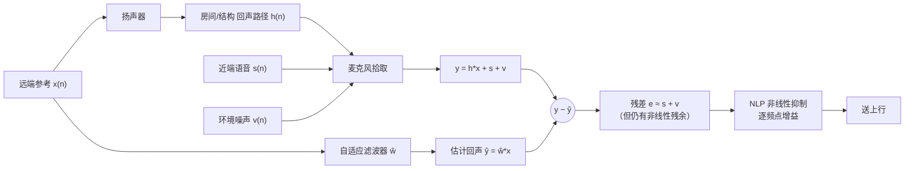
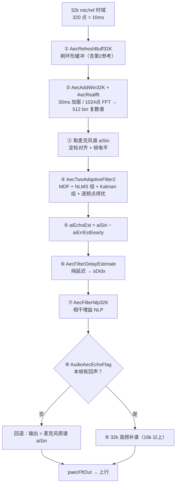
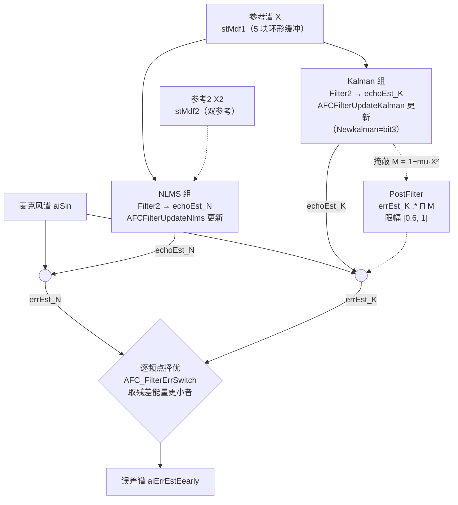
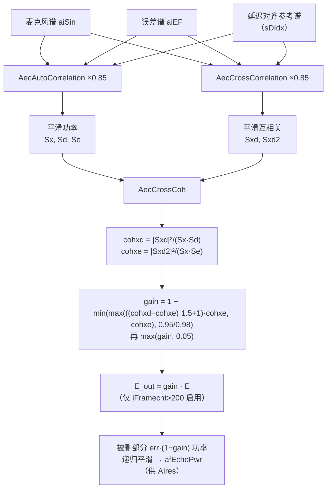
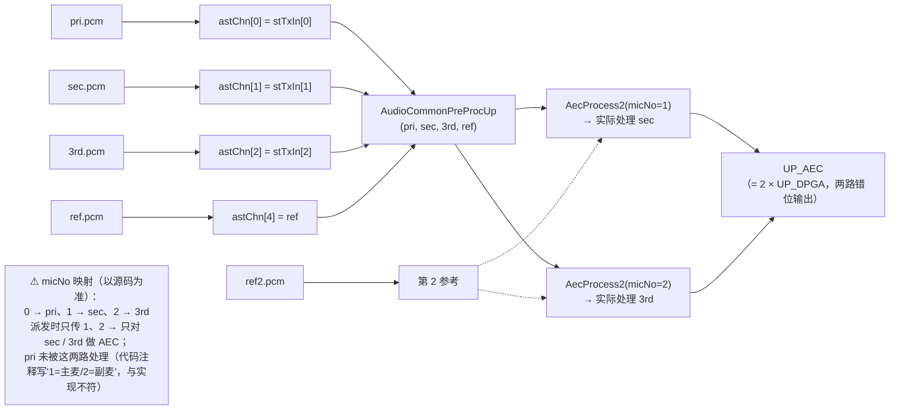
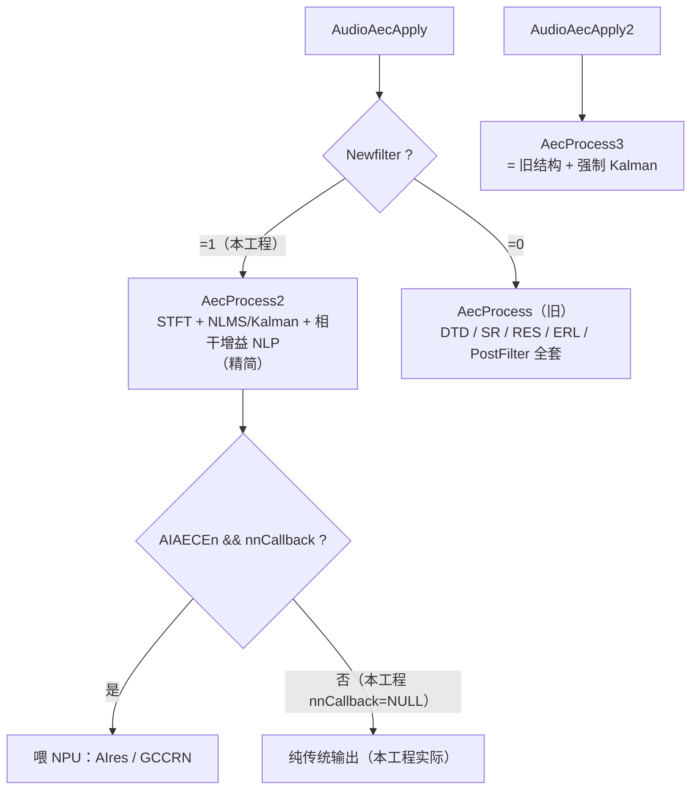

# 08 · AEC 算法链路逐步详解

> **用途**：沿着本工程实际走的 `AecProcess2` 主流程，**一步步入栈**，讲清"这一步在干嘛、用的是哪个算法、具体怎么算"。
> **面向**：没做过算法也能看懂——每一步先给**生活化类比**，再给**公式/步骤**，最后给**代码位置**。
> **和别的文档的分工**：[`03`](03-AEC流程-源码解读.md) 讲"函数调用链"、[`02`](02-AEC处理链路与原理.md) 讲"原理与数据流"、[`06`](06-AEC特色算法盘点.md) 讲"特色算法清单"；**本文是粒度最细的"逐步算法讲解"**。
> **代码位置**：`D:\code\48kAEC_Sim_Mini\libaudio_voice_3a_glasses\hifi\src_lib\aec\`（下文行号都对应该工程，会随改动漂移，**以函数名为准**）。
> **权威来源**：只读参考工程 `D:\code\48kAEC处理\docs\算法\` 下的 `AEC算法介绍.md`、`AEC算法原理（汇报版）.md`。若与参考工程冲突，以参考工程为准。
> **含框图**：全文有 **7 张图**——①回声模型、②主流水线、③双滤波核心、④相干增益 NLP、⑤链路分流（mermaid 流程图），⑥频域内存布局、⑦3 麦+2 参考接线（这几个为直观起见用 ASCII/mermaid）。GitHub 可直接渲染 mermaid；若你的编辑器不渲染，正文里的 ASCII 图同样可用。
> **名词不懂**：查 [`01-AEC术语表.md`](01-AEC术语表.md)。

---

## 0. 先建立直觉：AEC 到底在干什么

**回声怎么来的**：免提通话时，对端的声音经扬声器放出来，又被本机麦克风捡回去，对端就听见自己延迟返回的声音。

把"扬声器 → 空气/房间 → 麦克风"看成一个（近似）**线性系统**，冲激响应记作 `h(n)`：

```
麦克风信号  y(n) = h(n) * x(n)  +  s(n)  +  v(n)
                   └──回声────┘   └近端语音┘ └噪声┘
```

- `x(n)` = 参考信号（ref，将要送给扬声器的东西）；
- `h(n)` = 回声路径（房间+机身）；
- `s(n)` = 近端说话、`v(n)` = 噪声；`*` 是卷积。

AEC 只能看到 `x(n)` 和 `y(n)`，要**自己估出一个 `h` 的近似 `ŵ`**，算出估计回声 `ŷ = ŵ * x`，再从 `y` 里减掉：

```
e(n) = y(n) − ŷ(n)
```

收敛后 `ŵ ≈ h`，`e(n) ≈ s(n) + v(n)`（回声被抵消，近端保留）。



**但线性滤波只能消掉"能建模的那部分"**，还剩一堆消不掉的（扬声器过载失真、路径时变、没完全收敛……）。所以 AEC 是**两段式**：

| 段 | 干什么 | 手段 | 本工程实现 |
| :-- | :-- | :-- | :-- |
| ① 线性抵消 | 消**线性**回声 | 频域分块自适应滤波 | `AecTwoAdaptiveFilter2`（NLMS+Kalman） |
| ② 残余抑制 | 压**非线性**残余 | 逐频点增益 NLP | `AecFilterNlp32K`（相干增益） |

> 🌟 **本文最重要的一句话**（能省你很多困惑）：
> 本工程走的是**新链路** `AecProcess2`，它**只执行**上面这套简洁的两段式 + 少量辅助（STFT、延迟估计、回声标志）。
> 你在代码里能看到的 **DTD 双讲检测、ERL 估计、发散保护、RES/SR、倒谱先验 SNR、MCRA、基音/谐波、高频专门通道** —— **在本工程这条链路上都不会被调用**（它们属于旧链路 `AecProcess` 或 AI 分支）。这些"少见的算法"我在 [§13 专题](#13-专题链路上看见但本工程没启用的少见算法) 逐一讲清，但它们**不是**你现在跑的路径。

---

## 1. 一帧（10ms）的完整流水线

**入口**：`AudioAecApply`（`imedia_aec_api.cpp:3047`）→ `Newfilter=1` → `AecProcess2`（`imedia_aec_module_function.cpp:2301`）。

```
32k 麦克风/参考 时域（320 点 = 10ms）
  │
  ├─[1] AecRefreshBuff32K   把新一帧拼进环形缓冲（含第 2 路参考）
  ├─[2] AecAddWin32K        加 30ms sqrt-Hann 窗 + AecRealfft（1024 点 → 512 bin 复数谱）
  ├─[3] 取麦克风谱 aiSin     从 stTxIn[micNo].pFftOutBuf 拷贝并"定标对齐"
  │
  ├─[4] AecTwoAdaptiveFilter2   ★核心：MDF 分块 + NLMS 组 + Kalman 组 + 择优
  │        └── 输出误差谱 aiErrEstEearly
  ├─[5] 估计回声 = 麦克风谱 − 误差谱（aiEchoEst）
  ├─[6] AecFilterDelayEstimate  纯延迟估计 → sDIdx（给 NLP/回声标志用）
  ├─[7] AecFilterNlp32K         ★核心：相干增益，逐频点压残余回声
  │
  ├─[8] AudioAecEchoFlag   判本帧有无回声；无回声 → 输出回退为麦克风原谱
  └─[9] （回 AudioAecApply）32k 高频补谱（16k 以上）
        └── paecFftOut → 上行
```

**同一流程的框图（mermaid；GitHub 可直接渲染，其它编辑器若看不到就以左边 ASCII 图为准）：**



> 🖼️ 想把这幅流水线单独拿去贴 PPT？见同目录 [`图/08-主流水线.svg`](图/08-主流水线.svg)（**矢量图**，可缩放）与 [`图/08-主流水线.mmd`](图/08-主流水线.mmd)（mermaid 源，可再生成）。

| 步 | 函数 | 文件:行 | 一句话 |
| :--: | :-- | :-- | :-- |
| 1 | `AecRefreshBuff32K` | `module_function.cpp:754` | 刷环形缓冲 |
| 2 | `AecAddWin32K` / `AecRealfft` | `module_function.cpp:533` / `realfft.cpp:31` | 加窗 + FFT |
| 3 | 拷贝 + 定标 | `module_function.cpp:2429-2441` | 取麦克风谱、算帧电平 |
| 4 | `AecTwoAdaptiveFilter2` | `adaptivefilter_function.cpp:1104` | 自适应滤波减回声 |
| 5 | 复数相减 | `module_function.cpp:2462-2471` | 估计回声 |
| 6 | `AecFilterDelayEstimate` | `module_function.cpp:1115` | 纯延迟估计 |
| 7 | `AecFilterNlp32K` | `module_function.cpp:2132` | 相干增益 NLP |
| 8 | `AudioAecEchoFlag` | `module_function.cpp:1216` | 回声标志 / 回退 |
| 9 | 高频补谱 | `imedia_aec_api.cpp:3105-3131` | 16k 以上处理 |

下面逐步展开。

---

## 2. 进函数前：先搞懂"频域数据长什么样"

AEC 内部绝大多数运算发生在**频域**。三条约定先记住：

1. **一帧 10ms**：32k 下 = **320 个采样点**；STFT 用 **960 点（30ms）** 窗；FFT **1024 点**，得到 **512 个 bin**。
2. **频域是 Q31 定点 + 交错复数**：每个频点存成相邻两个 `int32`：`[实部, 虚部, 实部, 虚部, …]`。所以一块频谱长度 = `bin数 × 2 + 2 = 1026`。
3. **定标要对齐**：不同模块的频域数据可能差一个"右移位数"，靠 `sFftNorm`（来源定标）和 `sFftShift`（AEC 定标）相减后右移对齐（见第 3 步）。

| 量 | 32k 值 | 宏（`imedia_aec_define.h`） |
| :-- | :-- | :-- |
| 帧长 | 320 | `IMEDIA_AEC_FRAME_SIZE_32K` (`:200`) |
| STFT 窗 | 960 | `IMEDIA_AEC_STFTFRAME_NUM_32K` (`:203`) |
| bin 数 | 512 | `IMEDIA_AEC_BINSNUMBER_32K` (`:206`) |
| FFT 长度 | 1024 | `IMEDIA_AEC_BINSNUMBER2_32K` (`:209`) |
| MDF 块数 | **5** | `IMEDIA_AEC_BLOCK_NUM` / `IMEDIA_NEW_AEC_BLOCK_NUM` (`:217-218`) |
| `sFftShift` | 7 | `imedia_aec_api.cpp:1975` |

> ⚠️ **订正**：早期笔记/`06` 里写的 `IMEDIA_NEW_AEC_BLOCK_NUM = 12` 是**错的**，源码里 `= 5`（`imedia_aec_define.h:218`）。

### 图⑥ 频谱在内存里长什么样（ASCII 布局图）

```
一块 32k 频谱 = 1026 个 int32（ = bin 数 512 × 2 + 2 ）

下标:   0     1     2     3     4     5    ...   1022  1023   1024   1025
       re0   im0   re1   im1   re2   im2   ...   re511 im511  (Nyq)  (Nyq)
      └─bin0──┘    └─bin1──┘    └─bin2──┘         └──bin511─┘  └bin512┘
       0 Hz       ~31 Hz      ~62 Hz    ...      ~15969 Hz    ~16 kHz
                    （每 1 个 bin = 32000 / 1024 = 31.25 Hz）

• 相邻两个 int 组成一对 (实部 re, 虚部 im) → 一个复数频点 bin
• 真正有意义的 bin 是 0…511（0Hz ~ ≈15.97kHz），共 512 个；
  第 512 个（下标 1024/1025，奈奎斯特 ≈16kHz）是用 bin511 复制补齐的
  （`module_function.cpp:2501-2502`），不参与独立计算
• 因此“复数 bin 数”常说 513（含这个补位）
```

> **定标对齐**：拷贝麦克风谱时按 `来源sFftNorm − AEC的sFftShift` 做**算术右移**（见第 3 步），
> 保证不同模块的频域数据处在同一 Q 标度上，否则功率/相干全错。

---

## 3. 第 1 步：刷新环形缓冲 `AecRefreshBuff32K`

**生活类比**：像缝纫机下的布料——远端参考信号源源不断流进来，得先把它一段段拼到一条**首尾相接的带子（环形缓冲）**上，后面才能从中截出固定长度的一段去分析。

- 环形缓冲 `stMdf1.pasRinBuf` 长度 `IMEDIA_AEC_MAX_REFBUF_NUM_32K = (5+3)×320 = 2560`（`define.h:231`）。
- 写指针 `sRinBufSeat` 每帧前移 `320`，到尾部回卷（`module_function.cpp:769-774`）；拷当前帧时按回卷点分两段（`:775-785`）。
- **双参考**：`sRefNum==1 && 免提` 时，第 2 路参考也走一遍，存进 `stMdf2`（`:786-797`）。
- 同时算本帧参考的时域电平 `sCurFrmDbSF = AecGetFrameDb(psRin, 320)`（`:810`）。

---

## 4. 第 2 步：加窗 + STFT + 实数 FFT `AecAddWin32K`

**生活类比**：直接对截断的音频做分析，接缝处会"咔哒"响（频谱泄漏）。所以给这段音频套一个**两端渐弱、中间最强的锥形罩子（窗）**，再送进频谱分析仪。

- **窗**：`G_AUDIO_COMMON_ADDWINTAB30MS_32K`，长 960、Q15，是 **sqrt-Hann** 窗（验证：中心 32767，1/6 处正好 16384=0.5）。
- **重叠**：窗长 960 = 3 × 帧长 320，即**每前进 1/3 窗、3 个窗重叠，overlap = 2/3 (66.7%)**。
- **窗位置**：起点由写指针 `sRinBufSeat` 与纯延迟 `sPureDelaySeat` 对齐（`module_function.cpp:570-577`），让窗尾落在"延迟补偿后"的位置。
- **加窗**：`AE_MUL16X4` 一次乘 4 个 Q15 点（`:583-591`）；然后把 `[960, 1026)` **补零**到 1024 点（`:592-594`）。
- **FFT**：`AecRealfft(aiRef, 1024, …)`（`:596` → `imedia_aec_realfft.cpp:31`），内部 `AudioFftReal32x16`（PC 上由 cstub 用 C 模拟，真机是 HiFi 蝶形指令），并做归一化定标。
- **参考功率平滑**：`AecAutoCorrelation(aiRef, …, 0.85)`（`:598-603`），存平滑后的参考能量，供 NLMS/Kalman 归一化用。双参考对 `stMdf2` 再来一遍。
- **附加特征**：`AecTimeDomainProperties`（`:638`）算**频谱倾斜度** `aiXRC[]`（相邻样点互相关归一化）和**过零率** `iCrossZero`。

FFT 输出：**513 个复数 bin（DC ~ Nyquist），交错存放**；Nyquist 那个 bin 由前一 bin 复制（`module_function.cpp:2501-2502`）。

---

## 5. 第 3 步：取麦克风谱 + 定标 + 帧电平

麦克风的频谱在上一步的预处理（`AudioCommonPreProcUp`）里已经算好，存在 `stTxIn[micNo].pFftOutBuf`。这一步（`module_function.cpp:2429-2441`）：

```c
// 拷贝麦克风谱到工作区 aiSin，并右移对齐定标
AudioCommonVecCopyInt32(pstCommon->stTxIn[micNo].pFftOutBuf, bins*2+2, aiSin);
iTmp = pstCommon->stTxIn[micNo].sFftNorm - pstAecStat->sFftShift;
for (i...) aiSin[i] = AE_SRAA32S_scalar(aiSin[i], iTmp);   // 算术右移对齐
```

再算近端帧电平 `sCurFrmDbSD = AecGetFrameDb(psMicLow, 320)`（`:2440-2441`）。

#### 定标右移：为什么、怎么算（数值算例）

**为什么**：AEC 内部规定"频域数据的标度是 `sFftShift`"（32k 下 = **7**）。麦克风谱来自预处理，它的标度是 `sFftNorm`（由 `AudioCommonFft` 返回的 FFT 归一化位数，`imedia_common_process.cpp:607-613`）。两者不一样，必须先**右移对齐**，否则后面算相干 `coh=|Sxd|²/(Sx·Sd)` 时，`Sd/Sxd`（来自麦克风，未折标）与 `Sx`（AEC 内部参考，已是 `sFftShift`）**不在同一比例**，比值会出现 `2^(2△)` 的偏差，相干性就错了。

**公式**（源码 `module_function.cpp:2430-2432`）：

```c
iTmp = 来源 sFftNorm − AEC sFftShift(7);
aiSin[i] = AE_SRAA32S_scalar(aiSin[i], iTmp);   // 算术右移 iTmp 位 = ÷ 2^△（保留符号）
```

同样写法在整个工程里很常见（如 `micin.cpp:772` 的"规约到 7"、`:1661` 的"规约到 9"）：`iTmp = sFftNorm − 目标；右移 iTmp；sFftNorm = 目标`。

**数值算例**（假设来源 `sFftNorm = 9`，则 `iTmp = 9 − 7 = 2`，每个 int32 **右移 2 位 = ÷4**）：

| 情况 | 原值（int32，16 进制） | 真值含义 | 右移 2 位后 | 结果 |
| :-- | :-- | :-- | :-- | :-- |
| 正数 | `0x4000_0000` (= 2³⁰) | 约 +0.5（Q31） | `0x1000_0000` (= 2²⁸) | ÷4 ✓ |
| 负数 | `0xF000_0000` (= −2²⁸) | 约 −0.125 | `0xFC00_0000` (= −2²⁶) | ÷4，**符号保留** ✓ |
| 边界 | `0x8000_0001`（最小负附近） | ≈ −1.0 | `0xE000_0000` | 算术右移，向负方向取整 |

> 若来源本就是 7（`iTmp = 0`），则**不移位**。所以"来源标度"取决于预处理那一次 FFT 的归一化结果，不是常数。

---

## 6. 第 4 步：自适应滤波 `AecTwoAdaptiveFilter2`（核心）

**函数**：`imedia_aec_adaptivefilter_function.cpp:1104`（在 `AecProcess2:2450` 调用，`sFilterTime=1`）。

**生活类比**：在山谷里对着回声"反复试错"——你建一个反射模型去预测返回声，每次预测后看还差多少（残差），据此微调模型。这里更聪明：**同时养两个预测高手**，谁这一帧扣得干净就用谁。



### 6.1 MDF：多延迟分块频域滤波（"为什么能算这么快"）

房间冲激响应很长（几千抽头），时域直接卷积算不动。MDF（Multi-Delay Filter，多延迟滤波器）把长滤波器**切成若干延迟块**，每块在频域做一次复数乘加：

```
echoEst(f) = Σ_{j=0}^{B-1} WFb[j](f) · XFm[j](f)      // B = 5 块
```

- 结构 `STRU_IMEDIA_MDF_CHAN`（`define.h:394-429`），块数 `B = 5`。
- 环形缓冲里最近 5 帧远端频谱按"延迟从近到远"排成 `paiX[0..4]`（`adaptivefilter_function.cpp:1216-1219`）：

```c
k = pstChan->sXFmBufSeat;
for (i = 0; i < IMEDIA_NEW_AEC_BLOCK_NUM; i++) {   // 5
    paiX[i] = pBufXFmFix + k * iXFmBufSubLen;
    k = (k >= iXFmBufTail) ? 0 : (k + 1);
}
```

这就是"分块频域自适应滤波（PBFDAF/MDF）"：用 FFT 把卷积变成逐频点相乘，算力从 O(L) 降到 O(B·logN)。

### 6.2 求回声：`Filter2`

`Filter2`（`adaptivefilter_function.cpp:180`）= 复数乘加 + 相减：

```c
// 数学：echoEst = Σ_j WFb[j] .* XFm[j]；errEst = sin − echoEst
```

即"用 5 块系数 × 5 帧参考谱累加出估计回声，再从麦克风谱里减掉，得到误差谱"。

### 6.3 一组"耿直"的预测：NLMS 更新 `AFCFilterUpdateNlms`

NLMS（归一化最小均方）是自适应滤波的经典做法，按"误差 ÷ 参考能量"的比例调系数：

```
stepCoef = errEst ./ (R + protection)        // R = refPwr × blockNum
stepCoef = stepCoef × muErr
WFb      = WFb + stepCoef .* conj(XFm)
```

- 步长 `iMu = IMEDIA_AEC_Q31_0P10`（约 0.1）。
- 分母带 `protection`（取误差平滑能量并设下限），避免参考静音时除零/爆冲。
- 求倒数用**定点牛顿迭代** + 查表 `G_AUDIO_COMMON_TAB_INVQ30`（`kalman_nlms.cpp:726-779`）。
- 有**误差幅度约束** `AFCNlmsAdjustSignal1`：把误差幅度按 `sqrt(constrainErrPwr/err²)` 拉回，配合阈值 `NLMS_THRESHOLD_FIX0..3`（`define.h:289-292`）。
- **生活类比**：耿直的修正者——只按当前残差比例调整，简单、快，但环境突变时容易调过头。

### 6.4 另一组"会估不确定度"的预测：Kalman 更新 `AFCFilterUpdateKalman`

进入 `AFCFilterUpdateKalman`（`kalman_nlms.cpp:20`，本工程 `Newkalman=1` 走这条）。它对**每个频点**不仅存系数 `W`，还存一个"**我对这个频点有多不确定**"的协方差 `P`：

```
S    = Σ(X2 .* P) + R + eps          // X2 = |X|²
Mu   = P ./ S                        // 该频点该"信残差多少"
dWK  = Mu .* conj(X) .* ErrK
WK   = WK + dWK
P    = P + (Q − P .* Mu .* X2)       // 更新不确定度
P    = clamp(P, 0.01, 0.99)
Q    = 0.02·|dWK|² + 0.98·Q          // 过程噪声：环境变了就变大
```

- 常量：`alfa = 42949673`（0.02 Q31）、`alfa1 = 2104533975`（0.98 Q31）（`kalman_nlms.cpp:180-181`）。
- `Newkalman` 分支还会算一个**掩蔽** `M = 1 − mu·X2` 存进 `paiM`（`:266-275`），交给 `PostFilter`。
- 系数 Q 标 `wQK=28`（比 NLMS 的 `wQNlms=27` 高 1 位，`api.cpp:1981-1982`）。
- **生活类比**：会估不确定度的修正者——`P` 大（没把握）时更信残差、敢调；`P` 小（有把握）时保守。所以更稳、跟踪变化更平滑。

> NLMS 与 Kalman 的差别（源码可直接对照）：NLMS 走 `pBufWfblFix`（`wQNlms`），只按固定步长调；Kalman 走 `paiW`（`wQK`），额外维护 `P/Q/R` 自适应决定每个频点的更新力度。

### 6.5 二选一：逐频点择优 `AFC_FilterErrSwitch`

两组都算完后（`adaptivefilter_function.cpp:1279-1285`），用 `AFC_FilterErrSwitch`（`kalman_nlms.cpp:463`）**逐频点比较**两组的误差瞬时能量，谁小用谁：

```c
t = AE_LT64(f64ErrK, f64ErrN);        // Kalman 功率 < NLMS 功率 ?
AE_MOVT64(f64ErrN[i], f64ErrK[i], t); // 取更小者
```

**生活类比**：两个高手各报一个答案，挑"扣得更干净"（残差能量更小）的那个。这样在"NLMS 跟得快但抖"与"Kalman 稳但慢"之间取长补短。

### 6.6 Kalman 分支的后置掩蔽 `PostFilter`

`PostFilter`（`adaptivefilter_function.cpp:320`）只在新 Kalman 分支用到。它把每个延迟块的掩蔽 `paiM` **连乘**压成一维增益：

```
mask(f) = Π_j M_j(f)                  // 多条延迟块都"被远端占据"才保留
mask    = clamp(mask, 0.60, 1.0)
errEst  = errEst .* mask
```

**生活类比**：`M` 表示"这个频点被远端占据的程度"；只有整条延迟链都被强远端占据的频点才保留（掩蔽≈1），否则压低（最低 0.6），进一步压残余回声。

### 6.7 双参考 `stMdf2`

本工程 `sRefNum=1`（免提+双参考，见 [`07 §1.1`](07-上行处理链与AE指令.md)），第 2 路参考走**第二个 MDF 通道** `stMdf2`：NLMS 组用它对第一次误差再做一次滤波/更新（`adaptivefilter_function.cpp:1191-1194`），误差功率指针与 `stMdf1` 共享。

### 6.8 本链路里的"保护"有哪些

新链路**没有**外露的 `AecFilterDiverge`/ERL/DTD（见 §13），但保护在更新内部：
- NLMS 分母的 `protection` + 误差幅度约束（§6.3）；
- Kalman 的 `P` 下限 `pmin`（`= pmin1 × 1e-5`，`api.cpp:807-808`）与上下限 `clamp(P,0.01,0.99)`（§6.4）；
- `PostFilter` 掩蔽下限 0.6（§6.6）；
- 择优机制本身（§6.5）。

---

## 7. 第 5 步：估计回声 = 麦克风谱 − 误差谱

`AecProcess2`（`module_function.cpp:2462-2471`）用 SIMD 成对相减：

```c
aiEchoEst[i] = aiSin[i] − aiErrEstEearly[i];   // 残差→回声估计
```

（`aiErrEstEearly` 是上一步的线性滤波输出；`aiEchoEst` 供 NLP/回声标志对照用。）
若 `sigNetAiAec && 32K`，这份误差谱还会拷给 `paecLinearAiInput0` 供多麦后置（MMHF）使用（`:2456-2460`）。

---

## 8. 第 6 步：纯延迟估计 `AecFilterDelayEstimate`

**函数**：`module_function.cpp:1115`（AecProcess2:2472 调用）。

**生活类比**：先量出"回声比参考晚了多少拍"，滤波器才能对准位置。

**做法（注意：不是互相关，而是"滤波器系数能量峰值"法）**：
- 遍历 5 个滤波器块，在 **100Hz~3400Hz** 频带内累加每块系数的能量 `|W|²`（`:1149-1160`）；
- 取能量最大的块，映射成频谱环位置 `sDIdx`（`:1162-1175`）。

**直觉**：哪一延迟块的系数"长得最壮"，说明回声就在那个延迟位置。`sDIdx` 随后被 NLP 和回声标志用来取"延迟对齐的参考谱"。

---

## 9. 第 7 步：残余回声抑制 NLP `AecFilterNlp32K`（核心）

**函数**：`module_function.cpp:2132`（32k；16k 对照版 `AecFilterNlp` 在 `:1964`）。

**为什么需要它**：线性滤波只消**线性**部分，剩下扬声器非线性、路径时变、未收敛等残余。NLP 在**频谱上**逐频点判断："这个频点听起来更像残留回声，还是更像近端人声？"——像回声就压低，像人声就保留。

### 9.1 核心概念：相干性（coherence）

两个信号 `a`、`b` 在频率 `f` 的**相干性**衡量"它们在这个频点有多像"，取值 0~1：

```
coh_ab(f) = |P_ab(f)|² / ( P_aa(f) · P_bb(f) )
```

**直觉**：
- 某频点 **mic 与 ref 高度相干**（它俩步调一致）→ 说明这里主要是**回声** → 压低；
- 某频点 **mic 与残差高度相干**（残差像近端）→ 这里主要是**近端** → 保留。



### 9.2 计算流程

对 N=512 个频点（`module_function.cpp:2158-2169`）：

1. **平滑功率**（`AecAutoCorrelation`，平滑系数 0.85）：
   - `Sd` = 麦克风 `aiSin` 功率，`Se` = 误差 `aiEF`(=aiErrEstEearly) 功率，`Sx` = 参考 `paiXFmDIdx` 功率；
2. **平滑互相关**（`AecCrossCorrelation`，0.85）：
   - `Sxd = <ref, mic>`，`Sxd2 = <ref, err>`；
3. **相干**（`AecCrossCoh`，输出 Q15）：
   - `cohxd = |Sxd|² / (Sx·Sd)`，`cohxe = |Sxd2|² / (Sx·Se)`；
4. **合成增益**（逐频点，`module_function.cpp:2187-2258`）：

```
fgain = ((cohxd − cohxe) · 1.5 + 1) · cohxe
fgain = max(fgain, cohxe)             // 至少不弱于 cohxe
fgain = min(fgain, 0.95 或 0.98)      // 上限：低频(≤~3kHz)=0.95，高频=0.98
gain  = 1 − fgain
gain  = max(gain, 0.05)               // 下限：防"音乐噪声"、防过度伤近端
E_out = gain · E
```

- 常量：`1.5 → 805306368`(Q29)、`1.0 → 536870912`(Q29)、`0.05 → 107374182`(Q31)、上限 `0.95=2040109466` / `0.98=2104533975`（`define.h:160-180`）。
- **分频段**：以 bin `96`（≈3kHz，`module_function.cpp:2186`）为界，低频上限 0.95、高频 0.98（高频更保守，避免发闷）。

### 9.3 两个细节

- **前 2 秒旁路**：`if (iFramecnt > 200)` 才启用该增益（`:2188`），即前 200 帧（约 2s）先让滤波器收敛，不做相干压制。
- **记录残留回声功率**：把被删掉的部分 `err·(1−gain)` 的功率递归平滑后存进 `afEchoPwr[idx]`（`:2234-2279`），供 AIres/系数估计复用；`1kHz 以下`的参考瞬时功率存进 `refPow[idx]`。

> **和维纳/谱减的关系**：都是"按回声/近端的相对主导程度给频点增益"，区别是这里的"主导程度"由**相干性**这个解析量直接构造，不需要显式谱减。这正是本工程"少见"的地方。

---

## 10. 第 8 步：回声标志 `AudioAecEchoFlag` + 回退

**函数**：`module_function.cpp:1216`（AecProcess2:2528 调用）。

**生活类比**：判断"这一帧远端到底在不在放声音"。如果本帧根本没回声，就干脆让麦克风信号**原样通过**，别去压制它——避免把近端人声当回声误伤。

- 取延迟对齐（`sDIdx`）后的参考谱，算 `250Hz~3600Hz`（`echoFlagCal` 版为 `250Hz~5000Hz`）频带能量，转 dB（`AecPow2Db`）；
- 对 dB 做**非对称平滑**：上升快（α=0.6）、下降慢（α=0.995），得 `sXdBsm`（`:1250-1259`）；
- 门限：默认 `sXdBsm > 30dB` → `sEchoFlag=1`（`IMEDIA_AEC_Q8_30=7680`）；另有 40dB 的快速标志。

**回退**（`module_function.cpp:2530-2535`）：当 `!sEchoFlag` 时，把输出谱直接换回麦克风原谱 `aiSin`，即"无回声帧近端直通"。

---

## 11. 第 9 步：32k 高频补谱（`AudioAecApply`）

回到 `AudioAecApply`（`imedia_aec_api.cpp:3105-3131`）。AEC 只在 0~16kHz（32k）工作，16k 以上（48k 输出的上半频带）需要单独处理：

- `sigNetAiAec==0 && 32k` 时，看 `sHfqMeanhnled` 这个"高频已抑制程度"：
  - `< 0.80` → 判为**有回声**，把 `paecFftOut` 的 16k 以上**清零**（`:3111-3114`）；
  - 否则 → **非回声**，把麦克风的高频搬回 AEC 输出（`:3115-3126`，先做好定标对齐）。
- `HighBandEcho` 打开时直接 `higEchoFlg = sEchoFlag`（`:3129-3131`）。

**效果**：让 48k 输出在 16~24kHz 有合理内容，又不引入回声。

---

## 12. 第 10 步：副麦线性滤波 `AecMicFilter2`（本工程不启用）

`AecMicFilter2`（`adaptivefilter_function.cpp:1289`）给第 2/3 只麦克风各做一次 Kalman 线性滤波，输出喂给多麦后置（`paecLinearAiInput1/2`）。

**但**它被 `if (sSampleRate != 32K)` 包着（`module_function.cpp:2604`），本工程是 32K → **不调用**。免提的两路 AEC 其实是每帧对 `micNo=1/2` 各调一次完整 `AecProcess2`（见 [`07 §1.1`](07-上行处理链与AE指令.md)）。

### 图⑦ 3 麦 + 2 参考是怎么接进来的（易踩坑）



> 详细推导（`g_mic_num=3`、`REF_NAME/REF_NAME2`、`astChn` 布局、手免两路 `pUpAec/pUpAec_2`）见 **[`07 §1.1`](07-上行处理链与AE指令.md)**（权威篇），此处只给接线图。

---

## 13. 专题：链路上"看得见"但本工程没启用的少见算法

下面这些名字在代码里到处出现、也很"高级"，但**本工程这条新链路都不执行**。列出来是为了：① 读代码时不被绕晕；② 你哪天要走旧链路/AI 分支时知道它们在哪、干嘛。

> 判定依据：这些函数的**唯一调用点**都在旧链路 `AecProcess`（`module_function.cpp:1584/1614/1627/1633/1640`）或 `AecProcess3`（`:1872/1902/1915/1921/1928`）或 AIres 支路（`imedia_aec_aires_post.cpp`），**不在 `AecProcess2`（2301-2646）里**。

**哪条链路会跑，一张图看懂：**



### 13.1 旧链路 `AecProcess` 全貌

`AecProcess` 才有完整的老一代大套件：`AecDtdtc`(双讲) → `AecSearchPicth`(基音) → `AecSrAutoBefor`(场景SR/混响) → `AecResEstimate`(残余估计) → `AecErlEst`(ERL+发散) → `AecPostFilter`(判决引导+维纳+谐波+倒谱+高频) → `AecSrAutoAfter`。新旧对比见 [`06 §3`](06-AEC特色算法盘点.md)。

### 13.2 判决引导（decision-directed）先验 SNR `AecDecisionDirected`

`postfilter_function.cpp:39`。**类比**：判断"这帧有多少语音"，别只看当前帧（波动大），要用"上一帧认为的干净能量"再按当前证据修正：

```
Speech_var = 0.995·Speech_var_prev + 0.005·max(0, Input_power − Noise_var)
SNR_prio   = max(下限, Speech_var / Noise_var)
```

配套 `AecGainCalculation(32K)`（`:116/:171`）把 SNR 转成**维纳增益** `G = SNR/(SNR+1)`，再夹到 `[minGain, 1]`。属旧链路/AIres。

### 13.3 倒谱先验 SNR `AecCepstralPrioriSnrDima(32K)`

`postfilter_function.cpp:303/:593`。**倒谱** = 对"频谱的起伏"再做一次频谱；人声/回声的谐波结构在倒谱域表现为尖峰，便于分离。
做法：对数功率谱 → IFFT 得倒谱 → **按基音位置做低频校正 + 高频平滑**（平滑表 `G_AUDIO_AEC_CEP_FIX`）→ 变回谱域 → 干净语音能量 `÷` 噪声得先验 SNR（`AecPrioriSnrCep`）。属旧链路/AIres 的第三层降噪。

### 13.4 MCRA 噪声估计 `AecMcra2Estimator` / `AecGetNoiseEstimate(32K)`

`basic_function.cpp:229/:295/:508`。**类比**：噪声地板跟踪器——每帧每频点一边快速跟踪当前能量，一边记"最近该频点的最低能量"当作背景噪声；当前能量明显高于最低值（有语音）就**冻结**噪声估计，否则慢慢更新：

```
speechMinima = (上升) speechEst  /  (下降) gamma·speechMinima + …
vad          = delta·speechMinima < speechEst
noiseEst     = alpha·noiseEst + (1−alpha)·power      // alpha 受 VAD 控
```

属 AIres/SR 支路，主干 NLP 不用。

### 13.5 基音搜索 + 谐波恢复

- `AecSearchPicth(32K)`（`basic_function.cpp:1858/:1903`）：对功率谱取对数再做 IFFT 得倒谱，在候选区间找**第一个超过门限 0.36** 的点作为基音 pitch。
- `AecHarmonicRestore`（`postfilter_function.cpp:228`）：有 pitch 时，把误差谱 IFFT 到时域**取正半波**再 FFT 回来，重建谐波结构，避免近端语音被消得发闷。
属旧链路/AIres。

### 13.6 高频专门通道 `AecHighFreqProc` / `AecHnlmGain`（含分段 ERL）

- `AecHighFreqProc`（`postfilter_function.cpp:881`）：**低频已强抑制则高频随之清零**（用低频可靠判断指导高频）。高频波长短、扬声器/麦高频差异大、线性滤波对不齐，残留回声更重；但又有辅音，不能一刀切。
- `AecHnlmGain`（`:1091`）：用**分段 ERL** 估计每频段最大衰减量：`Est_Echo = Sx·ERL`，`tmp = max(0, Est_Echo − Sy)`，`hnlM = max(0, 1 − tmp/Se)`；再做"快降慢升"平滑。
属旧链路（`sHfqMeanhnled` 这个被高频补谱用到的量也来自旧链路的 `AecPostMultGain`）。

### 13.7 双讲检测 DTD 一族

`AecDtdtc`（`module_function.cpp:238`）、`AecDtdtcForMode/Num`、`AecJudgeDtOne/Two` + `AecStd`（`SR_function.cpp:957/999/1071`）、`AecDtdtcPro`（`postfilter_function.cpp:1031`）。
**类比**：判断"是只有对方在说（单讲，回声该消）还是我也在说（双讲，不能把我的声音消掉）"。判据：ref 与 mic 的**相干性**、能量比、SRL/ERL 跟踪、测试序列峰值计数等；双讲期**降速/冻结**更新。本工程新链路不外露 DTD（不显式检测）。

### 13.8 发散保护 `AecFilterDiverge` / `AecHfDiverge` / `AecOtherDiverge`

`RES_function.cpp:418/:319/:368`。**类比**：判断"回声反射模型是不是学歪了"——若远处残留回声反而比近处估计还大、且频带特征异常，就置 `sFilterDiverge`，后续降增益/重置。由 `AecErlEst` 调用（`RES_function.cpp:1196`），属旧链路。

### 13.9 SBSS：频域矩阵自适应（RLS/Kalman 类）

`audio_vqe_voice_sbss_api.cpp`。对每个子带维护一个 **5 阶复数滤波器 `W`** 和一个**逆相关矩阵 `P`**：`P` 决定"步长尺度"，`W` 决定"增益方向"。

- `AecSbssUpdatePINT`(:260)：`P ← P − gain·(Refᴴ·P)/α`（协方差更新）；
- `AecSbssNormalizePINT`(:275)：把 `P` 修正成 **Hermitian 矩阵**（实部对称、虚部反对称）；
- `AecSbssUpdateWINT`(:313)：`W ← W + Gain·EstErr`；
- `AudioSbssVecHermiSubINT`(:146)、`AudioSbssVecvecMultAddComplexINT`(:156)：Hermitian 差、复数共轭点积；
- `AudioSbssDivergeRistrictInt`(:324)：发散抑制——误差能量若超过麦克风能量，按 `sqrt(micPwr/errPwr)` 缩回。
- 开关 `SbssSwitch`（`ucTmp` bit5）。本工程该位为 0，**不启用**；且 32K 的 NLP 分叉优先走 `AecFilterNlp32K`，SBSS 分支只在非 32K 才可能命中。

### 13.10 AIres / GCCRN：神经网络残余抑制

`imedia_aec_aires_post.cpp` + `audio_vqe_voice_aires_api.cpp`。在传统 NLP 之外多一路**神经网络**做残余回声抑制（"AIres"，从命名看是 CRN/GCCRN 类），经 NPU 推理。

- 传统兜底链：`AudioVqeVoiceAecAIresPost(32K)` → `AecSearchPicth32K` → `AecCoefficient32K2` → `AecResEstimate32K2` →（MCRA）→ `AecPostFilter32K2`（倒谱先验 SNR + 维纳 + 高频）。
- NN 增益应用：`AudioVqeVoiceAiResGCCRNGainApplyFix`（`audio_vqe_voice_aires_api.cpp:15`）把网络给的增益 `g` 以 `g·|g|` 的复数形式乘到线性输出上。
- **接入开关**：`if (AIAECEn && nnCallback)`（`module_function.cpp:2507`）。`AIAECEn` 由 `ucPureDelay≥150` 置 1（只表示"允许 AI"），但 `nnCallback`（真正挂载的 NPU 回调）本工程为 `NULL` → **恒走传统分支**。

---

## 14. 速查表：每步算法 → 函数 → 位置 → 开关

| 步 | 算法 | 函数 | 文件:行 | 开关 | 本工程 |
| :--: | :-- | :-- | :-- | :-- | :--: |
| 1 | 环形缓冲 | `AecRefreshBuff32K` | `module_function.cpp:754` | 采样率 32K | ✅ 启用 |
| 2 | sqrt-Hann 窗 + STFT | `AecAddWin32K` | `module_function.cpp:533` | 采样率 32K | ✅ |
| 2 | 实数 FFT | `AecRealfft` | `realfft.cpp:31` | — | ✅ |
| 4 | MDF 分块 + 复数乘加 | `Filter2` | `adaptivefilter_function.cpp:180` | — | ✅ |
| 4 | NLMS 系数更新 | `AFCFilterUpdateNlms` | `kalman_nlms.cpp:571` | — | ✅ |
| 4 | Kalman 系数更新 | `AFCFilterUpdateKalman` | `kalman_nlms.cpp:20` | `Newkalman`(bit3) | ✅ |
| 4 | 逐频点择优 | `AFC_FilterErrSwitch` | `kalman_nlms.cpp:463` | — | ✅ |
| 4 | Kalman 后置掩蔽 | `PostFilter` | `adaptivefilter_function.cpp:320` | `Newkalman` | ✅ |
| 6 | 纯延迟估计 | `AecFilterDelayEstimate` | `module_function.cpp:1115` | — | ✅ |
| 7 | 相干增益 NLP | `AecFilterNlp32K` | `module_function.cpp:2132` | 采样率 32K | ✅ |
| 8 | 回声标志 | `AudioAecEchoFlag` | `module_function.cpp:1216` | — | ✅ |
| 9 | 32k 高频补谱 | （内联） | `imedia_aec_api.cpp:3105` | `sigNetAiAec==0` | ✅ |
| 12 | 副麦 Kalman 滤波 | `AecMicFilter2` | `adaptivefilter_function.cpp:1289` | 非 32K | ❌ |
| 13 | 判决引导 / 维纳增益 | `AecDecisionDirected` / `AecGainCalculation` | `postfilter_function.cpp:39/:116` | 旧链路/AIres | ❌ |
| 13 | 倒谱先验 SNR | `AecCepstralPrioriSnrDima32K` | `postfilter_function.cpp:593` | 旧链路/AIres | ❌ |
| 13 | MCRA 噪声估计 | `AecMcra2Estimator`/`AecGetNoiseEstimate32K` | `basic_function.cpp:229/:508` | AIres/SR | ❌ |
| 13 | 基音 / 谐波恢复 | `AecSearchPicth32K` / `AecHarmonicRestore` | `basic_function.cpp:1903` / `postfilter_function.cpp:228` | 旧链路/AIres | ❌ |
| 13 | 高频专门通道 | `AecHighFreqProc` / `AecHnlmGain` | `postfilter_function.cpp:881/:1091` | 旧链路 | ❌ |
| 13 | 双讲 DTD | `AecDtdtc` / `AecStd` / `AecJudgeDt*` | `module_function.cpp:238` / `SR_function.cpp:1071/:957/:999` | 旧链路 | ❌ |
| 13 | 发散保护 | `AecFilterDiverge` | `RES_function.cpp:418` | 旧链路(经 `AecErlEst`) | ❌ |
| 13 | ERL 估计/更新 | `AecErlEst` / `AecErlUpdate` | `RES_function.cpp:1094/:199` | 旧链路 | ❌ |
| 13 | SBSS 频域矩阵自适应 | `AecSbssUpdatePINT` 等 | `audio_vqe_voice_sbss_api.cpp:260…` | `SbssSwitch`(bit5) | ❌ |
| 13 | AIres/GCCRN | `AecAIresPost32K` / `AudioVqeVoiceAiResGCCRN*` | `aires_post.cpp` / `aires_api.cpp:15` | `AIAECEn && nnCallback` | ❌ |

> 开关位：`Newfilter`=bit0、`DoubleRef`=bit1、`Newkalman`=bit3、`sigNetAiAec`=bit4、`SbssSwitch`=bit5（`imedia_aec_api.cpp:734-743`）。本工程 `ucTmp=(1<<0)|(1<<3)|(1<<4)|(1<<6)`。

---

## 15. 相关文档

- [`00-AEC新手导读.md`](00-AEC新手导读.md) ｜ [`01-AEC术语表.md`](01-AEC术语表.md)
- [`02-AEC处理链路与原理.md`](02-AEC处理链路与原理.md) —— 原理与数据流
- [`03-AEC流程-源码解读.md`](03-AEC流程-源码解读.md) —— 调用链
- [`06-AEC特色算法盘点.md`](06-AEC特色算法盘点.md) —— 特色算法清单 / 新旧链路对比
- [`07-上行处理链与AE指令.md`](07-上行处理链与AE指令.md) —— 3 麦+参考的整条上行 + AE 指令
- 动手调试：`D:\code\48kAEC_Sim_Mini\AecMini\README.md`、`AecMini\代码讲解.md`
